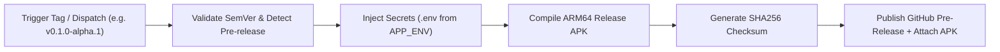

# 📦 BazaarSetu Android APK Release & Strict Versioning Guide

This guide explains how **BazaarSetu (Project ZeroType)** Android release APKs are packaged, how strict semantic versioning is automatically enforced, and how to trigger releases.

---

## 🎯 1. Why Release Builds Are Separate from Daily CI

In professional mobile engineering, daily pull requests and commits to `main` run **Continuous Integration (Lint & Tests)**, while **APK Release Packaging** is executed as a dedicated, controlled workflow:

1. **Build Efficiency & Speed**: Compiling a production Android ARM64 APK takes 3–5 minutes. Running full release compilation on every minor commit or documentation edit wastes GitHub Actions minutes.
2. **Release Stability & Quality Assurance**: Every published APK should represent a deliberate, thoroughly tested milestone, not an intermediate development state.
3. **Immutable Version Traceability**: Each released APK is cryptographically checksummed (SHA-256) and permanently tied to an immutable Git Tag (e.g. `v1.0.0`), guaranteeing that the APK running on a seller's phone can be mapped back to the exact source commit.

---

## 🔐 2. Production Secrets & Environment File Injection (`.env`)

Flutter packages the `.env` asset into the APK at compile time. To ensure release APKs contain real API credentials (`GROQ_API_KEY`, `BHASHINI_*`, `BACKEND_URL`) rather than placeholder `.env.example` values, GitHub Actions injects the repository secret **`APP_ENV`**:

### How to set the `APP_ENV` Secret:
**Option A: 1-Click via GitHub CLI (Recommended)**:
```bash
# Upload your local .env as an encrypted GitHub secret
gh secret set APP_ENV < .env
```

**Option B: Via GitHub Web Interface**:
1. Go to repository **Settings** $\rightarrow$ **Secrets and variables** $\rightarrow$ **Actions**.
2. Click **New repository secret**.
3. Name: `APP_ENV`
4. Value: Paste the full contents of your production `.env` file $\rightarrow$ **Add secret**.

If `APP_ENV` is configured, GitHub Actions automatically writes it to `.env` before running `flutter build apk --release`.

---

## 🔢 3. How Strict Versioning & Alpha Releases Work

Android and Flutter distinguish between two version identifiers:
* **Version Name (`versionName` / `--build-name`)**: The human-readable Semantic Version (e.g., `0.1.0-alpha.1`, `1.0.0`).
* **Version Code (`versionCode` / `--build-number`)**: An integer that **strictly increases monotonically** with each build (`${{ github.run_number }}`).

### Alpha / Pre-Release Detection:
When publishing an alpha, beta, or release candidate:
- If the version name contains `alpha`, `beta`, `rc`, `dev`, or `preview` (e.g., `v0.1.0-alpha.1`), GitHub Actions automatically flags the release as a **Pre-release** on GitHub.



---

## 🚀 4. How to Trigger an Alpha or Production Release

### Method A: Via Git Tag (Recommended)

```bash
# 1. Ensure you are on main and up to date
git checkout main
git pull origin main

# 2. Tag the release (e.g. Alpha v0.1.0-alpha.1)
git tag -a v0.1.0-alpha.1 -m "Release v0.1.0-alpha.1: Alpha preview release"

# 3. Push tag to GitHub (triggers workflow)
git push origin v0.1.0-alpha.1
```

### Method B: Via GitHub CLI (Workflow Dispatch)

```bash
gh workflow run release-apk.yml -f version="0.1.0-alpha.1" -f prerelease=true
```

### Method C: Via GitHub Web Interface

1. Navigate to: `https://github.com/NotTheAmmar/project-zerotype/actions/workflows/release-apk.yml`
2. Click **Run workflow**.
3. Version: `0.1.0-alpha.1` (or leave blank to use `pubspec.yaml`).
4. Check **Mark as Pre-release on GitHub**.
5. Click **Run workflow**.

---

## 📥 5. Downloading & Installing the APK

Once the workflow completes (~3 minutes):
1. Navigate to the **Releases** tab on GitHub:
   `https://github.com/NotTheAmmar/project-zerotype/releases`
2. Download `BazaarSetu-v<VERSION>-build<N>.apk`.
3. To install directly on an Android device via USB debugging:
   ```bash
   adb install -r BazaarSetu-v1.0.0-build1.apk
   ```

---

## 📋 5. Pre-Release Quality Checklist

Before tagging a new version for release:
- [ ] Run `flutter analyze` locally to ensure zero warnings or lints.
- [ ] Run `flutter test` to ensure all 33+ automated test cases pass.
- [ ] Verify that the desired backend URL (`BACKEND_URL` and `BPP_BACKEND_URL`) in `.env` is reachable.
- [ ] If bumping versions, update `pubspec.yaml` (e.g. `version: 1.0.1+1`).
