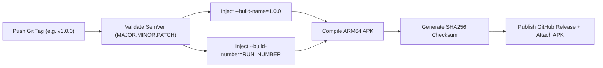

# 📦 BazaarSetu Android APK Release & Strict Versioning Guide

This guide explains how **BazaarSetu (Project ZeroType)** Android release APKs are packaged, how strict semantic versioning is automatically enforced, and how to trigger releases.

---

## 🎯 1. Why Release Builds Are Separate from Daily CI

In professional mobile engineering, daily pull requests and commits to `main` run **Continuous Integration (Lint & Tests)**, while **APK Release Packaging** is executed as a dedicated, controlled workflow:

1. **Build Efficiency & Speed**: Compiling a production Android ARM64 APK takes 3–5 minutes. Running full release compilation on every minor commit or documentation edit wastes GitHub Actions minutes.
2. **Release Stability & Quality Assurance**: Every published APK should represent a deliberate, thoroughly tested milestone, not an intermediate development state.
3. **Immutable Version Traceability**: Each released APK is cryptographically checksummed (SHA-256) and permanently tied to an immutable Git Tag (e.g. `v1.0.0`), guaranteeing that the APK running on a seller's phone can be mapped back to the exact source commit.

---

## 🔢 2. How Strict Versioning Works (Automated)

Android and Flutter distinguish between two version identifiers:
* **Version Name (`versionName` / `--build-name`)**: The human-readable Semantic Version shown in app settings, ONDC network registries, and app stores (e.g., `1.0.0`, `1.1.2`).
* **Version Code (`versionCode` / `--build-number`)**: An integer that **strictly increases monotonically** with each build. Android OS and Google Play use this integer to determine whether an APK is an upgrade over the currently installed version.

### Automated Version Resolution in GitHub Actions:
Our workflow ([`.github/workflows/release-apk.yml`](file:///home/ammar/Programs/project-zerotype/.github/workflows/release-apk.yml)) automates this completely:



1. **Tag Parsing**: When you push tag `v1.0.0`, the workflow validates that it matches strict Semantic Versioning (`^[0-9]+\.[0-9]+\.[0-9]+`).
2. **Build Number Injection**: The workflow automatically injects GitHub's monotonically increasing `${{ github.run_number }}` as `--build-number`. You never have to manually increment build numbers in code!
3. **Artifact Naming**: The resulting file is formatted with its version:
   `BazaarSetu-v1.0.0-build<N>.apk`
   `BazaarSetu-v1.0.0-build<N>.sha256`

---

## 🚀 3. How to Trigger an APK Release

You can trigger a release through either of two methods:

### Method A: Via Git Tag (Recommended & Standard)

Run these commands in your local terminal:

```bash
# 1. Ensure you are on main and up to date
git checkout main
git pull origin main

# 2. Create an annotated SemVer tag
git tag -a v1.0.0 -m "Release v1.0.0: Initial BazaarSetu prototype release"

# 3. Push the tag to GitHub
git push origin v1.0.0
```

That's it! GitHub Actions will immediately:
1. Trigger the **Build Release APK** workflow.
2. Compile the production APK.
3. Generate the SHA-256 verification hash.
4. Create a formal **GitHub Release** titled `BazaarSetu v1.0.0 (Build X)` with the APK and checksum attached.

---

### Method B: Via GitHub Web Interface (One-Click Dispatch)

If you want to trigger a build without touching the terminal:
1. Navigate to your repository on GitHub:
   `https://github.com/NotTheAmmar/project-zerotype/actions/workflows/release-apk.yml`
2. In the banner, click **Run workflow**.
3. (Optional) Enter a custom Semantic Version (e.g. `1.0.1`), or leave it blank to automatically extract the version from `pubspec.yaml`.
4. Ensure **Publish as GitHub Release** is checked.
5. Click the green **Run workflow** button.

---

## 📥 4. Downloading & Installing the APK

Once the workflow completes (~3 minutes):
1. Navigate to the **Releases** tab on GitHub:
   `https://github.com/NotTheAmmar/project-zerotype/releases`
2. Download `BazaarSetu-v<VERSION>-build<N>.apk`.
3. To install directly on an Android device via USB debugging:
   ```bash
   adb install -r BazaarSetu-v1.0.0-build1.apk
   ```

---

## 📋 5. Pre-Release Quality Checklist

Before tagging a new version for release:
- [ ] Run `flutter analyze` locally to ensure zero warnings or lints.
- [ ] Run `flutter test` to ensure all 33+ automated test cases pass.
- [ ] Verify that the desired backend URL (`BACKEND_URL` and `BPP_BACKEND_URL`) in `.env` is reachable.
- [ ] If bumping versions, update `pubspec.yaml` (e.g. `version: 1.0.1+1`).
