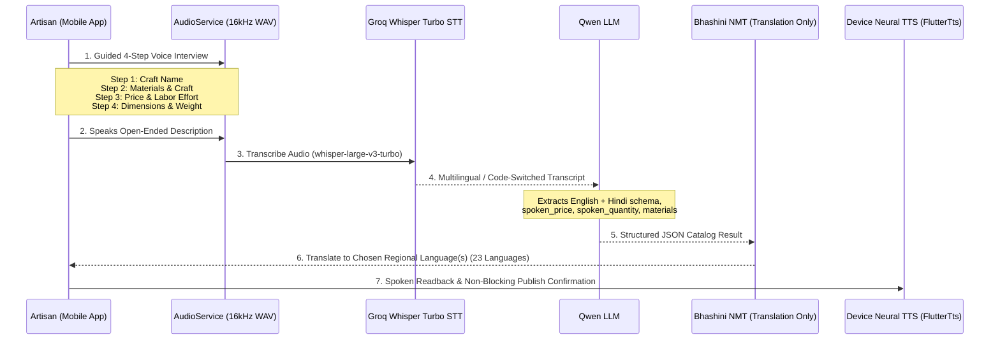

# BazaarSetu: Voice Pipeline Architecture (Project ZeroType)

This document details the voice-to-catalog pipeline in **BazaarSetu** (Project ZeroType). It specifies how open-ended spoken artisan narratives across 23 supported languages are transcribed, structured by **Qwen** into ONDC Beckn catalog schemas, translated via **Bhashini NMT**, and read back via Device Neural TTS.

---

## 1. High-Level Pipeline Flow

---

## 2. Engine Responsibilities (Whisper STT + Bhashini NMT + Device TTS)

1. **Speech-to-Text (`Whisper` via Groq)**:
   - Uses `whisper-large-v3-turbo` (`POST /openai/v1/audio/transcriptions` authenticated by `QWEN_API_KEY`) for accurate, code-switched Hindi, Hinglish, English, and regional Indian language transcription without requiring strict language matching at capture time.
   - Bhashini ASR has been removed in favor of Whisper's native multilingual robustness.
2. **Text-to-Text Translation (`BhashiniService.translate` — NMT Only)**:
   - Bhashini Dhruva ULCA is dedicated exclusively to Neural Machine Translation (`taskType: 'translation'`, cached per `translation:sourceLanguage:targetLanguage`).
   - Used for UI localization (`LanguageController`), guided interview prompts (`VoiceScreen`), post-publish confirmations (`CatalogController`), and translating English titles/descriptions into any of the **23 supported Indian languages** for `localizedTitles` & `localizedDescriptions` (both during initial creation and edits).
3. **Text-to-Speech (`FlutterTts` Device Neural Voice)**:
   - Uses the device's neural `FlutterTts` engine tuned for the active language `ttsLocale` (`en-IN`, `hi-IN`, `ta-IN`, etc.).
   - Bhashini Cloud TTS was removed to eliminate robotic synthesis, WAV format distortion, and unnecessary network latency.

---

## 3. Language Display vs. Storage & ONDC Contract

- **In-App Display**: Respects the artisan's onboarding choice — **Single Language** (displays 1 selected language across headings, labels, dialogs, and cards via `AppStrings` & `BilingualText`) or **Bilingual** (displays their chosen 2 languages).
- **Supabase & ONDC Storage**: Always persists `title_en` + `description_en` (mandatory ONDC RET12 descriptors) and `title_hi` + `description_hi` in Supabase PostgreSQL columns, while preserving any extra regional translations in `localized_titles` and `localized_descriptions` JSONB fields.

---

## 4. Open-Ended Capture & Audio Safety Lifecycle

- **Guided 4-Step Voice Interview**: (1) Craft Name, (2) Materials & Technique, (3) Selling Price, Raw Cost & Labor Days, (4) Dimensions & Weight (paired with optional manual input).
- **Audio Format**: 16 kHz Mono WAV (`AudioEncoder.wav` on mobile, `AudioEncoder.opus` on web), no 15-second duration cap.
- **Audio Interruption Safety**: All TTS playback and recording sessions stop immediately when tapping the mic, switching steps, closing modals, or navigating away.
- **Non-Blocking Publish Confirmation**: Publishing to ONDC immediately updates UI state and shows the confirmation dialog while confirmation TTS plays asynchronously in the user's selected language.
