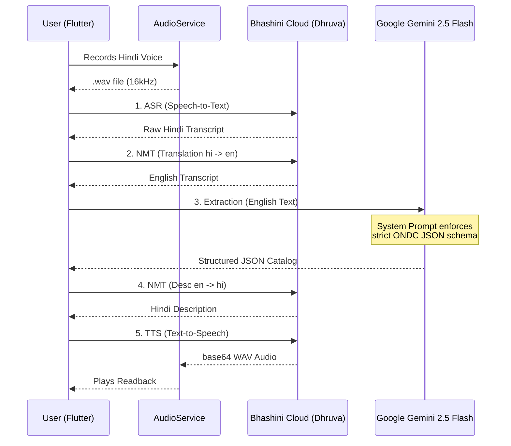

# Voice & AI Processing Architecture

This document outlines the end-to-end flow of the KalaKriti voice-to-catalog pipeline. The architecture is designed to be fully serverless on the voice side, directly connecting the Flutter client to scalable cloud AI APIs without requiring a middleman backend.

## 1. High-Level Flow

The voice pipeline orchestrates 5 distinct AI calls to produce a structured ONDC Beckn catalog item and a localized audio readback.



## 2. Component Breakdown

### A. Audio Capture (`audio_service.dart`)
- **Codec:** Uses `AudioEncoder.wav`. Bhashini is highly strict about audio formats; sending MPEG4/AAC (`.m4a`) results in Internal Server Errors (500).
- **Sample Rate:** 16kHz, mono channel.
- **Delivery:** Encodes the `.wav` file to a Base64 string for transmission to the Bhashini API.

### B. Bhashini Integration (`bhashini_service.dart`)
Handles the 2-step Dhruva API architecture required by MeitY:
1. **Config Discovery (`getModelsPipeline`)**: Uses `BHASHINI_USER_ID` and `BHASHINI_ULCA_KEY` to discover the active `serviceId`s for ASR, Translation, and TTS for the requested languages. Results are cached per session.
2. **Inference Compute (`/services/inference/pipeline`)**: Uses the `BHASHINI_API_KEY` to execute the actual machine learning tasks.
   - **ASR**: Transcribes the base64 WAV to Indic text.
   - **NMT**: Translates Indic text to English, and vice versa.
   - **TTS**: Synthesizes Hindi text back into base64 WAV for playback.

### C. LLM Extraction (`api_service.dart`)
- **Model:** `gemini-2.5-flash`
- **Why English?**: Regional dialects and code-switched Hindi can cause hallucinations in structural JSON mapping. Translating to English first (via Bhashini) ensures Gemini operates on its strongest language, resulting in near 100% schema adherence.
- **Temperature:** Set to `0.2` to prioritize deterministic formatting over creative text generation.

### D. Controller Orchestration (`catalog_controller.dart`)
- Manages the UI state (`ProcessingStage`) while the pipeline runs asynchronously.
- Handles the final TTS fallback: If the Bhashini network request fails during audio readback generation, the controller gracefully falls back to the device's native `flutter_tts` engine so the artisan still hears their confirmation.

## 3. Environment Variables Required

For the voice pipeline to function, the following must be defined in the `.env`:

```env
# Bhashini Auth (From Bhashini Dashboard)
BHASHINI_API_KEY=xxx
BHASHINI_ULCA_KEY=xxx
BHASHINI_USER_ID=xxx

# Bhashini Config
BHASHINI_PIPELINE_ID=64392f96daac500b55c543cd
BHASHINI_API_URL=https://dhruva-api.bhashini.gov.in

# Gemini Auth
GEMINI_API_KEY=xxx
GEMINI_MODEL=gemini-2.5-flash
```

## 4. Error Handling & Edge Cases
- **Empty Voice Input:** Caught by `audio_service` amplitude thresholds before hitting the API.
- **Bhashini 500 Errors:** Usually format related. Always ensure the client sends strict `wav` or `flac` bytes.
- **JSON Parsing Errors:** If Gemini hallucinated markdown fences (e.g. ````json`), the fallback regex in `api_service.dart` strips them before `jsonDecode`.
