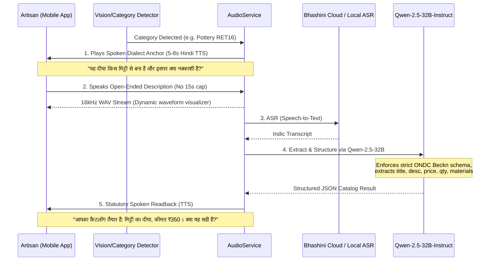

# BazaarSetu: Voice Pipeline Architecture (Project ZeroType)

This document details the voice-to-catalog pipeline in **BazaarSetu** (Project ZeroType). It specifies how open-ended spoken artisan narratives are anchored by visual category detection and structured by **Qwen** into valid ONDC Beckn catalog schemas.

---

## 1. High-Level Pipeline Flow



---

## 2. Modality Details

### A. Category-Adaptive Spoken Anchors
Rather than opening the microphone into an empty prompt, the system queries the detected category and plays a targeted, localized question before recording:
- **Pottery (`ONDC:RET16`)**: *"यह दीया किस मिट्टी से बना है और इसपर क्या नक्काशी है? (What clay is this diya made from, and what carvings does it have?)"*
- **Apparel / Weaves (`ONDC:RET12`)**: *"यह कपड़ा किस धागे से बुना गया है और इसपर क्या कढ़ाई की गई है? (What yarn was used and what embroidery is featured?)"*
- **Food / Spices (`ONDC:RET10`)**: *"यह खाद्य सामग्री कैसे तैयार की गई है और इसमें कौन से मसाले हैं? (How was this prepared and what ingredients/spices are in it?)"*
- **Wood / Metalcraft**: *"यह हस्तशिल्प किस धातु या लकड़ी से गढ़ा गया है? (What metal or wood is this craft carved from?)"*

### B. Open-Ended Voice Capture
- **No 15-Second Limit**: The artisan may speak as long as necessary. The UI provides an open-ended count-up timer (`MM:SS`) with a live 30-bar amplitude waveform.
- **Audio Specification**: 16 kHz Mono WAV format (`AudioEncoder.wav`).
- **Silence & Under-run Protection**: If speech amplitude drops or duration is insufficient, the artisan is gently prompted to speak naturally.

### C. Qwen Catalog Extraction (`api_service.dart`)
- **Default Model**: `qwen-2.5-32b-it` (via Groq OpenAI-compatible free API or custom inference server).
- **Temperature**: `0.1` for maximum schema reliability and determinism.
- **System Prompt**:
```text
You are an expert Indian artisan product cataloguer for the ONDC (Open Network for Digital Commerce) e-commerce network.
You convert spoken artisan descriptions (Hindi, Hinglish, or English) into structured ONDC Beckn catalog JSON.

Return ONLY a valid JSON object matching the target schema:
{
  "title_en": "Product title in English",
  "title_hi": "उत्पाद का हिंदी नाम",
  "category": "apparel|pottery|metalcraft|woodwork|food|jewelry|decor|handicrafts",
  "materials": ["primary material", "secondary material"],
  "dimensions": "length x width x height or size",
  "care_instructions": "Care instructions in English",
  "craft_technique": "Name of craft technique",
  "lead_time": "Production lead time",
  "origin_cluster": "Artisan cluster / village / region",
  "fair_price": 350,
  "available_quantity": 5,
  "description_en": "Rich evocative artisan story in English",
  "description_hi": "हिंदी में विवरण"
}
```

### D. Spoken Price & Quantity Routing
If the artisan explicitly mentions price (e.g. *"मैं इसे साढ़े तीन सौ में बेचता हूँ"*) or quantity (*"मेरे पास पांच पीस तैयार हैं"*), Qwen extracts `fair_price: 350` and `available_quantity: 5`. These values automatically pre-populate the **Fair-Price Corridor** card and **Tactile Quantity Stepper** on the catalog screen.

### E. Readback & Verification
Before publishing, the artisan hears the readback summary:
> *"आपका कैटलॉग तैयार है: [श्रेणी] [शीर्षक], कीमत ₹[कीमत]। क्या यह सही है?"*
