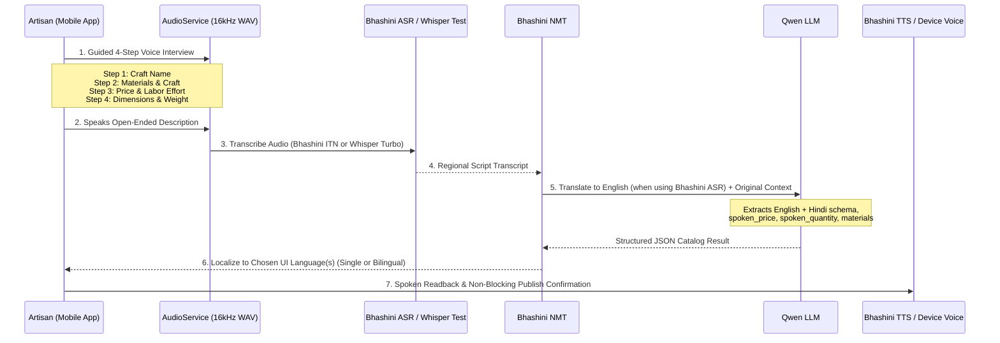

# BazaarSetu: Voice Pipeline Architecture (Project ZeroType)

This document details the voice-to-catalog pipeline in **BazaarSetu** (Project ZeroType). It specifies how open-ended spoken artisan narratives across 23 supported languages are transcribed, translated, structured by **Qwen** into ONDC Beckn catalog schemas, and read back cleanly.

---

## 1. High-Level Pipeline Flow

---

## 2. Pipeline Modes (`VoicePipelineMode`)

A compact **Voice Mode (Test)** toggle on `ExploreScreen` lets teams compare two pipelines side by side without altering the AppBar layout:

1. **`Bhashini` Mode (Default)**:
   - **ASR**: Per-language ULCA model lookup (`_taskConfigs` keyed by `taskType:sourceLanguage:targetLanguage`) with `postProcessors: ['itn', 'punctuation']` (converting spoken numbers into digits like `₹350`).
   - **NMT**: Translates non-English ASR transcripts into English before Qwen extraction, and translates `title_en` / `description_en` into the user's selected regional language(s).
   - **TTS**: Bhashini Dhruva TTS requested at **22,050 Hz** and converted from 32-bit IEEE Float WAV (`wFormatTag == 3`) into standard **16-bit PCM WAV (`wFormatTag == 1`)** with ~1.4 dB headroom via `BhashiniService.normalizeWavToPcm16` for crisp Android playback.
2. **`Whisper` Mode (Hybrid Testing)**:
   - **STT**: Groq `whisper-large-v3-turbo` (`POST /openai/v1/audio/transcriptions` using `QWEN_API_KEY`) for language-agnostic and mixed Hinglish/code-switched speech recognition.
   - **NMT**: Still uses Bhashini NMT for localizing catalog text into any of the 23 supported Indic languages.
   - **TTS**: Device-native `FlutterTts` using the Android Speech Services neural voice for `ttsLocale` (e.g., `hi-IN`, `en-IN`, `ta-IN`).

---

## 3. Language Display vs. Storage & ONDC Contract

- **In-App Display**: Respects the artisan's onboarding choice — **Single Language** (displays 1 selected language across headings, labels, dialogs, and cards via `AppStrings` & `BilingualText`) or **Bilingual** (displays their chosen 2 languages).
- **Supabase & ONDC Storage**: Always persists `title_en` + `description_en` (mandatory ONDC RET12 descriptors) and `title_hi` + `description_hi` in Supabase PostgreSQL columns, while preserving any extra regional translations in `localized_titles` and `localized_descriptions` JSONB fields.

---

## 4. Open-Ended Capture & Audio Safety Lifecycle

- **Guided 4-Step Voice Interview**: (1) Craft Name, (2) Materials & Technique, (3) Selling Price, Raw Cost & Labor Days, (4) Dimensions & Weight (paired with optional manual input).
- **Audio Format**: 16 kHz Mono WAV (`AudioEncoder.wav` on mobile, `AudioEncoder.opus` on web), no 15-second duration cap.
- **Audio Interruption Safety**: All TTS playback and recording sessions stop immediately when tapping the mic, switching steps, closing modals, or navigating away.
- **Non-Blocking Publish Confirmation**: Publishing to ONDC immediately updates UI state and shows the confirmation dialog while confirmation TTS plays asynchronously in the user's selected language.
